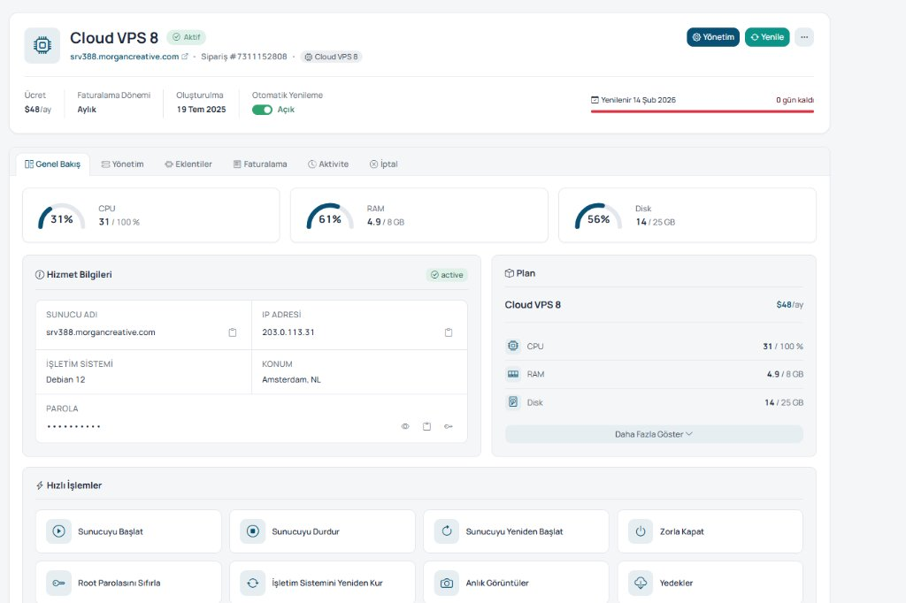
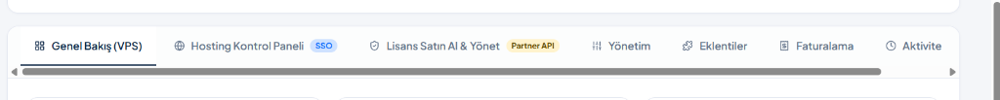
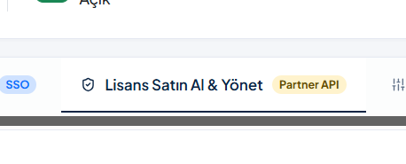
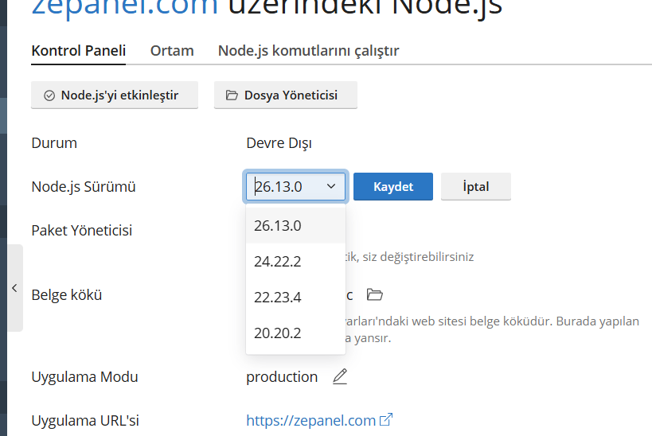
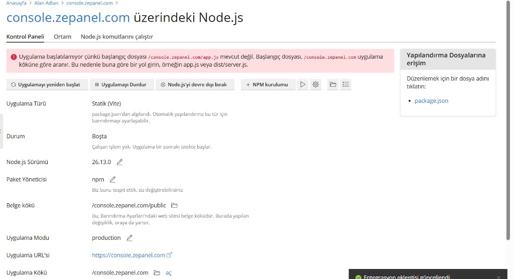

# zPanel Sunucu Kontrol Paneli

zPanel, modern web hosting ve bulut sunucu (VPS/VDS) altyapılarını yönetmek üzere geliştirilmiş yüksek performanslı sunucu kontrol panelidir.

Resmi Web Sitesi: https://www.zepanel.com

---

## Ekran Görüntüleri

### 1. VPS / VDS Yönetim Ekranı


### 2. Web Hosting & Reseller Ekranı


### 3. Lisans Provizyonlama & Partner API


### 4. Yönetici Düğüm & Paket Eşleme


### 5. Sistem Mimarisi & Güvenlik Şeması


---

## Resmi Port Standartları

- 8056 / TCP (HTTPS): Güvenli REST API Portu
- 8026 / TCP (HTTPS): Müşteri Kontrol Paneli & SSO
- 8036 / TCP (HTTPS): Bayi (Reseller) / Root Yönetici Paneli & SSO
- 8046 / TCP (HTTPS): Webmail Paneli
- 8047 / TLS: Bakım & İlk Kurulum Paneli

---

## Resmi Eklentiler

### WHMCS Eklentileri
- [zpanel-vps-whmcs](https://github.com/zepanel/zpanel-vps-whmcs)
- [zpanel-hosting-whmcs](https://github.com/zepanel/zpanel-hosting-whmcs)
- [zpanel-license-whmcs](https://github.com/zepanel/zpanel-license-whmcs)

### WISECP Eklentileri
- [zpanel-vps-wisecp](https://github.com/zepanel/zpanel-vps-wisecp)
- [zpanel-hosting-wisecp](https://github.com/zepanel/zpanel-hosting-wisecp)
- [zpanel-license-wisecp](https://github.com/zepanel/zpanel-license-wisecp)

### PNLCS Eklentileri
- [zpanel-vps-pnlcs](https://github.com/zepanel/zpanel-vps-pnlcs)
- [zpanel-hosting-pnlcs](https://github.com/zepanel/zpanel-hosting-pnlcs)
- [zpanel-license-pnlcs](https://github.com/zepanel/zpanel-license-pnlcs)

---

## Kurulum

Temiz bir Linux sunucusunda (Ubuntu / Debian):

```bash
curl -sSL https://get.zepanel.com/install.sh | bash
```

Resmi site ve destek: https://www.zepanel.com
