<div align="center">
  
  <br><br>
  <h1>zPanel v2 — Yeni Nesil Linux Web Hosting ve Sunucu Kontrol Paneli</h1>
  <p><strong>Linux sunucularınızı, web sitelerinizi, e-postalarınızı, veritabanlarınızı ve güvenlik politikalarınızı tek merkezden yönetin.</strong></p>
  <p>
    <a href="https://www.zepanel.com">Resmi Web Sitesi</a> •
    <a href="https://www.zepanel.com/downloads">İndirme Merkezi</a> •
    <a href="https://www.zepanel.com/product">Ürün Detayı</a> •
    <a href="https://www.zepanel.com/features">Özellikler</a> •
    <a href="https://www.zepanel.com/pricing">Lisanslar</a> •
    <a href="https://www.zepanel.com/wiki">Dokümantasyon</a>
  </p>
</div>

---

## 🚀 zPanel v2 Nedir?

**zPanel v2**, modern web hosting şirketleri, veri merkezleri, sistem yöneticileri ve yazılım geliştiriciler için Go ve C tabanlı çekirdekle optimize edilmiş, ultra düşük bellek tüketen, yüksek performanslı ve kurumsal düzeyde bir **Linux Sunucu ve Web Hosting Kontrol Paneli**'dir.

Sunucunuzda Apache, Nginx, PHP-FPM, MySQL/MariaDB, Postfix, Dovecot ve Güvenlik Duvarı yönetimini karmaşık konsol komutlarından kurtararak modern, reaktif ve hızlı bir kullanıcı arayüzü sunar.

> [!NOTE]
> Bu depo, **zPanel v2 Resmi Kontrol Paneli**'nin tanıtım dokümantasyonunu, arayüz ekran görüntülerini ve resmi dağıtım paketlerini (Debian, Ubuntu, AlmaLinux/RHEL ve Kurulum Motoru) içerir. zPanel çekirdeği ticari kapalı kaynak bir yazılımdır; açık kaynak kod barındırmaz.

---

## 🖥️ zPanel v2 Kontrol Paneli Arayüzü & Ekran Görüntüleri

zPanel v2'nin 26 temel modülünün gerçek panel arayüz ekranları aşağıda sunulmuştur:

### 1. Giriş ve Kimlik Doğrulama Ekranı
Çift faktörlü koruma (2FA), brute-force saldırı kalkanı ve güvenli oturum açma arayüzü.
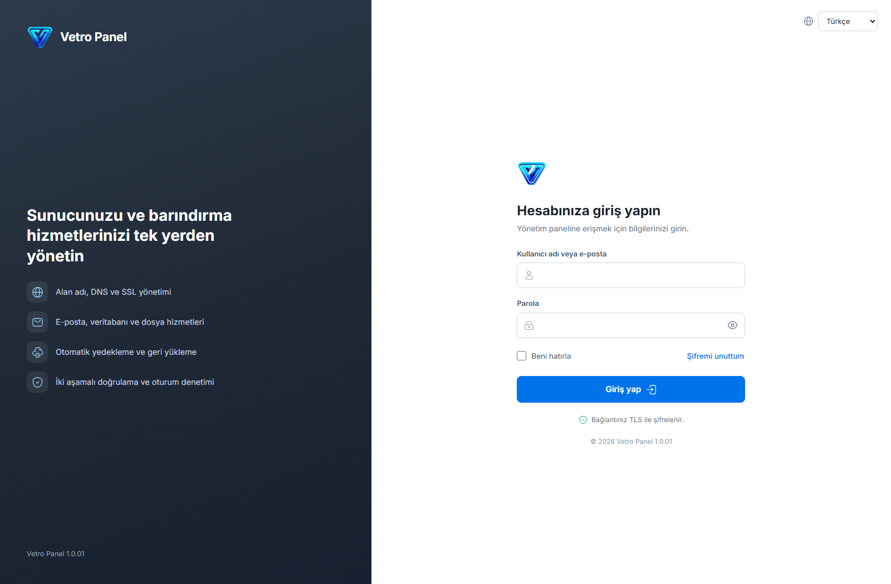

### 2. Yönetici ve Müşteri Dashboard (Genel Bakış)
Sunucu kaynak tüketimi (CPU, RAM, Disk, Ağ), anlık yük, aktif hizmetler ve hızlı erişim widget'ları.
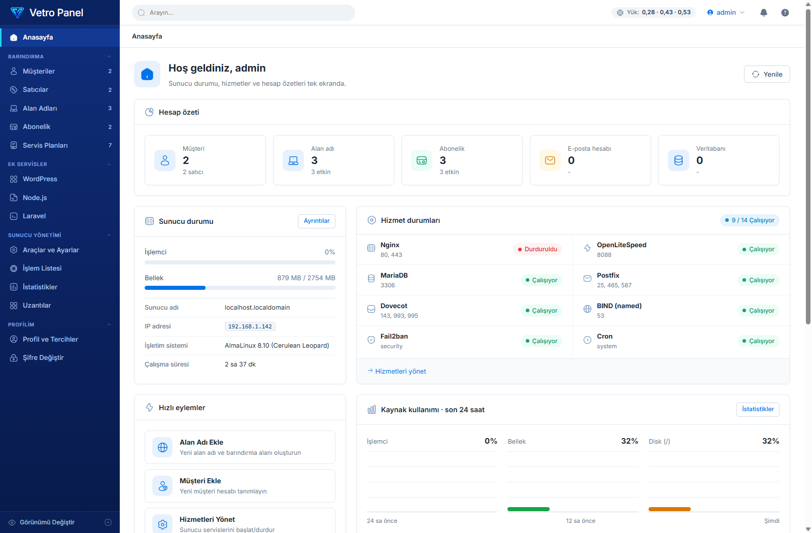

### 3. Alan Adları ve Web Siteleri Yönetimi
Çoklu alan adı, alt alan adı (subdomain), takma ad (alias) ve web sitesi yapılandırmaları.
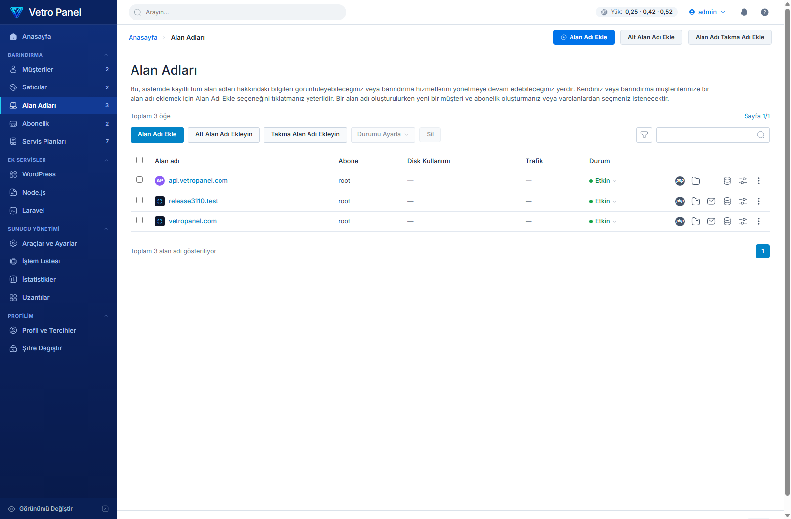

### 4. Alan Adı Detaylı Yönetim Paneli
Her web sitesi için kök dizin, SSL, PHP sürümü, log izleme ve erişim izinleri.
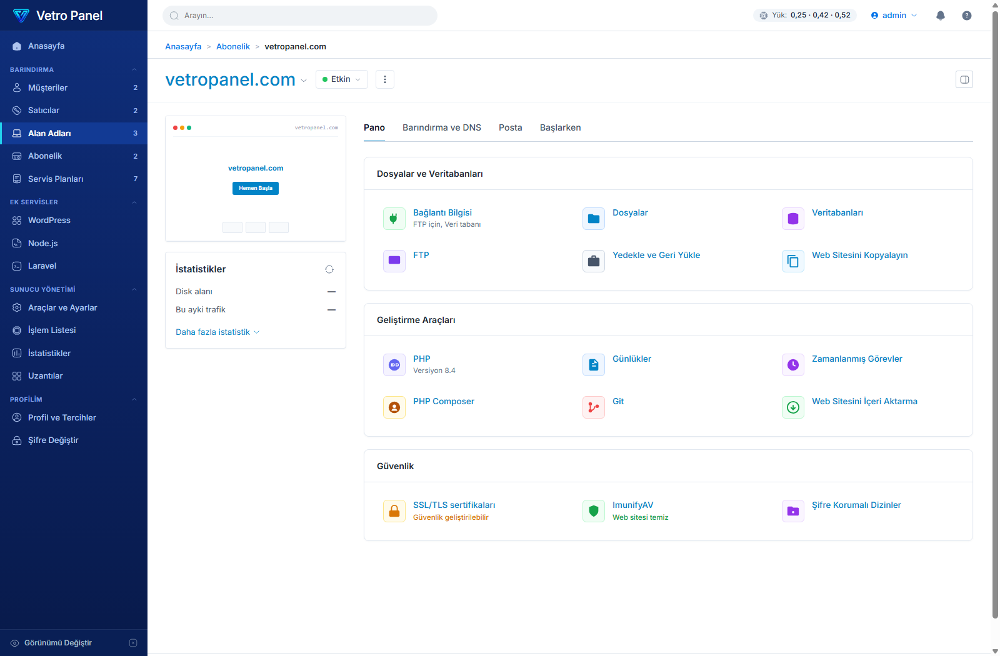

### 5. Veritabanları (MySQL / MariaDB)
Veritabanı oluşturma, boyut takibi ve phpMyAdmin entegrasyonu.


### 6. Veritabanı Kullanıcıları ve Yetkilendirme
Kullanıcı bazlı detaylı GRANT yetkilendirmesi ve şifre yönetimi.
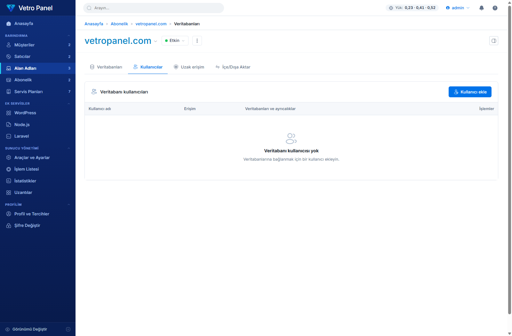

### 7. Veritabanı Uzak Erişim (Remote MySQL)
Güvenli IP beyaz listeleme ile dış IP'lerden veritabanına doğrudan güvenli bağlantı.
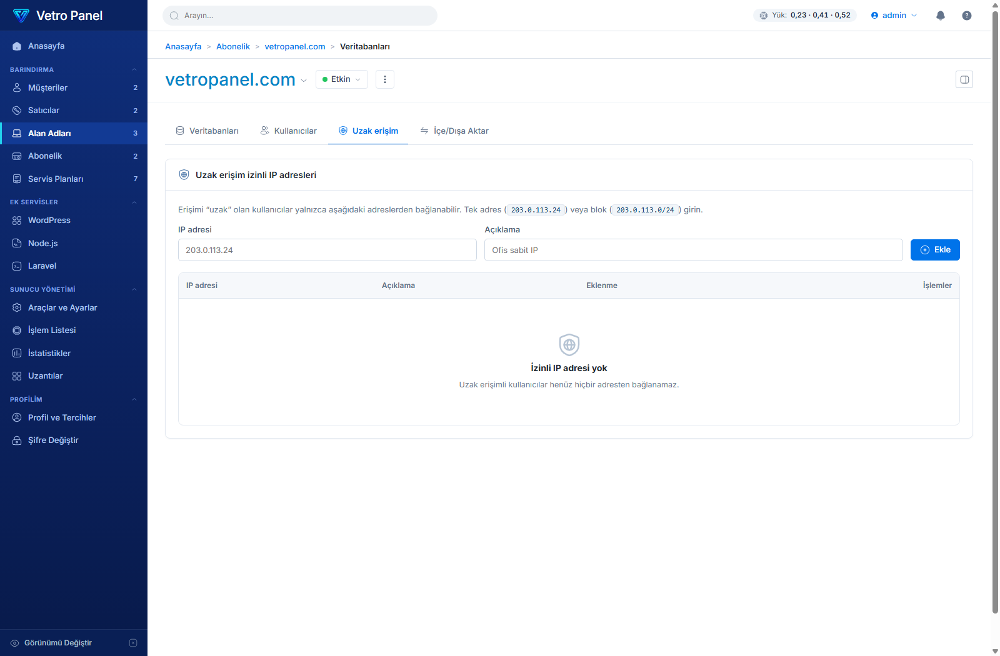

### 8. Veritabanı İçe ve Dışa Aktarma (SQL Dump / Import)
Büyük SQL dosyalarını tek tıkla yükleme, yedekten dönme ve gzip dışa aktarma.
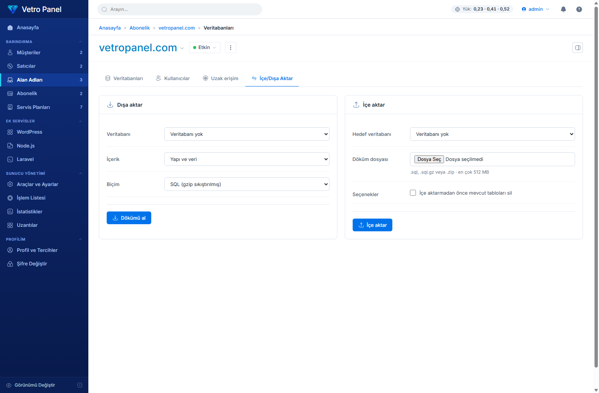

### 9. Gelişmiş Web Tabanlı Dosya Yöneticisi
Sürükle-bırak dosya yükleme, ZIP sıkıştırma/açma, sözdizimi vurgulamalı hızlı kod düzenleyici ve chmod izin yönetimi.
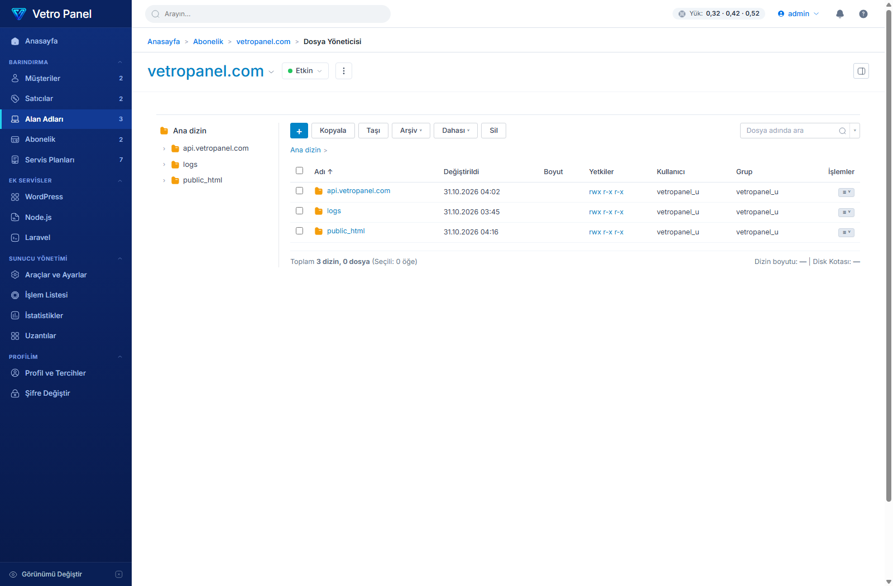

### 10. E-Posta Hesapları Yönetimi
Kişiselleştirilmiş e-posta hesapları, kota tanımlama, otomatik yanıtlayıcı ve yönlendirme kuralları.


### 11. E-Posta Güvenlik & DNS Kimlik Doğrulama
Spam koruması, SPF, DKIM ve DMARC kayıtlarının tek merkezden otomatik yapılandırılması ve doğrulanması.


### 12. DNS Bölge (Zone) Yönetimi
A, AAAA, CNAME, MX, TXT, SRV, NS kayıtlarının TTL desteğiyle anında yönetimi.
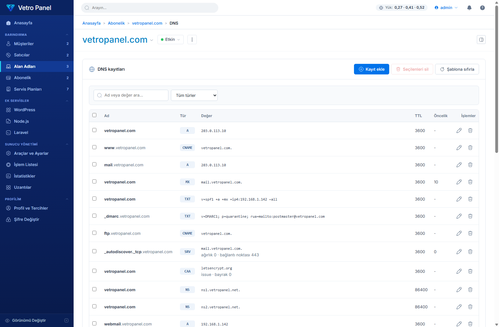

### 13. SSL / TLS Sertifikaları
Tek tıkla Let's Encrypt Wildcard ve Otomatik SSL kurulumu, özel ticari SSL yükleme ve HTTP'den HTTPS'e otomatik yönlendirme.


### 14. Çoklu PHP Sürüm & Yapılandırma Yönetimi
Site bazında PHP 7.4, 8.0, 8.1, 8.2, 8.3 seçimi, `upload_max_filesize`, `memory_limit`, `max_execution_time` ve OPcache ayarları.


### 15. FTP Hesapları ve Dizin İzolasyonu
İzole edilmiş web dizinleri için FTP hesabı açma, kota ve bağlantı sınırlamaları.
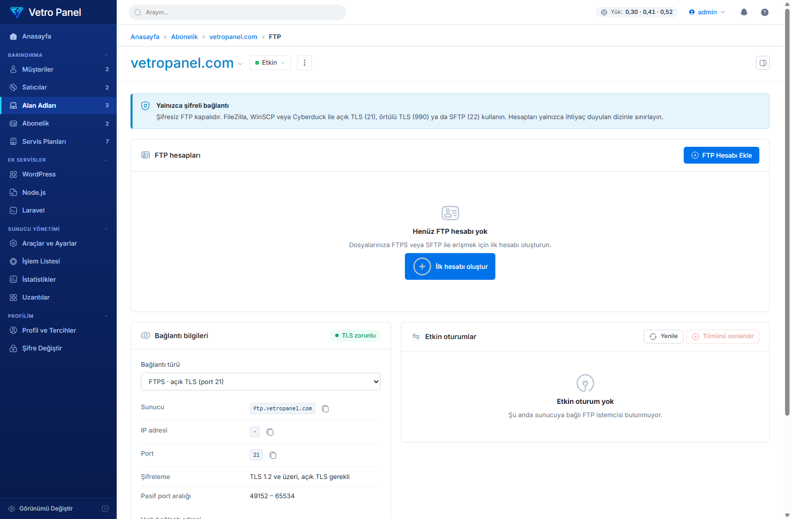

### 16. Cron (Zamanlanmış Görevler) Yönetimi
Dakikalık, saatlik, günlük veya özel cron sözdizimi ile komut çalıştırma ve çıktı günlükleri.
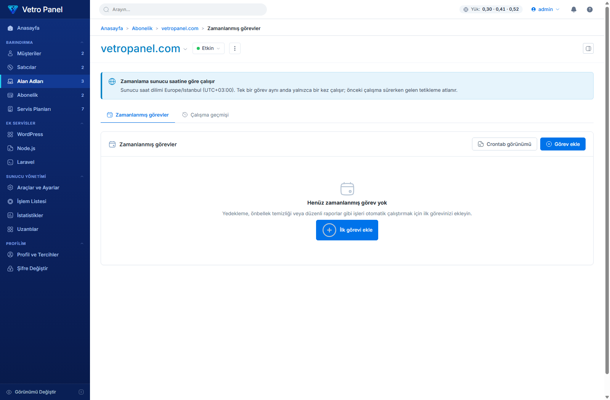

### 17. Otomatik ve Manuel Yedekleme Yönetimi
Web dosyaları, veritabanları ve e-postalar için zamanlanmış otomatik yedekleme, yerel veya uzak depolama.
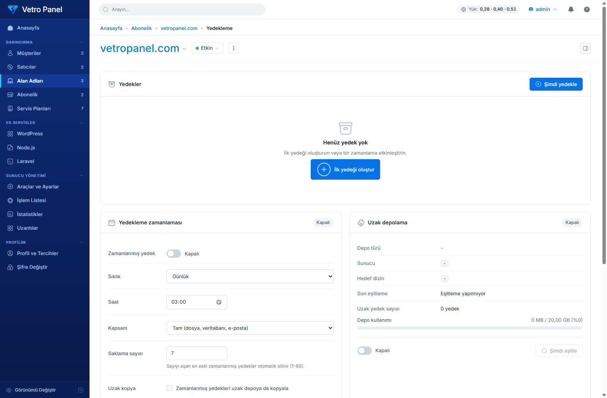

### 18. Araçlar ve Sistem Kontrol Merkezi
Sunucu sağlık taraması, güvenlik açığı denetimi, port kontrolleri ve tek tıkla onarım araçları.


### 19. Sistem Servisleri Yönetimi
Nginx, Apache, PHP-FPM, MySQL, Postfix, Dovecot ve Cron servislerinin anlık durumu, başlatma, durdurma ve yeniden başlatma.
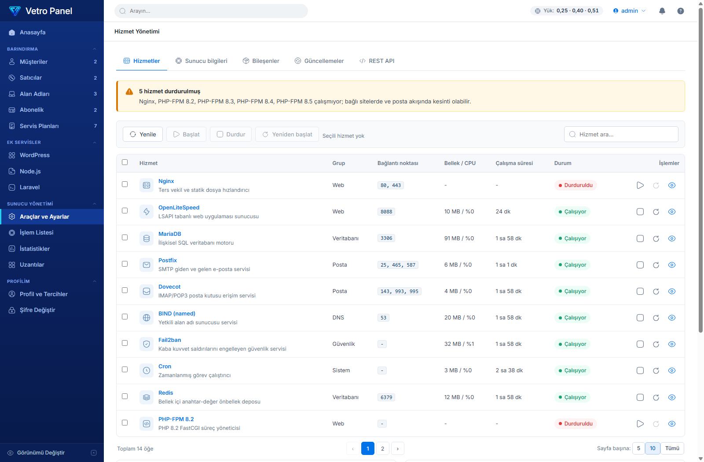

### 20. Postfix & Mail Kuyruğu Detayı
Giden/gelen e-posta kuyruğu inceleme, takılan e-postaları temizleme veya yeniden gönderme.


### 21. Güvenlik Duvarı & Fail2ban IP Engelleme
Brute-force saldırganlarını otomatik yakalayan Fail2ban entegrasyonu, banlanan IP listesi ve anında kural ekleme.


### 22. Müşteriler Listesi
Hosting müşterilerinin hesapları, atanan paketler ve kaynak tüketim limitleri.
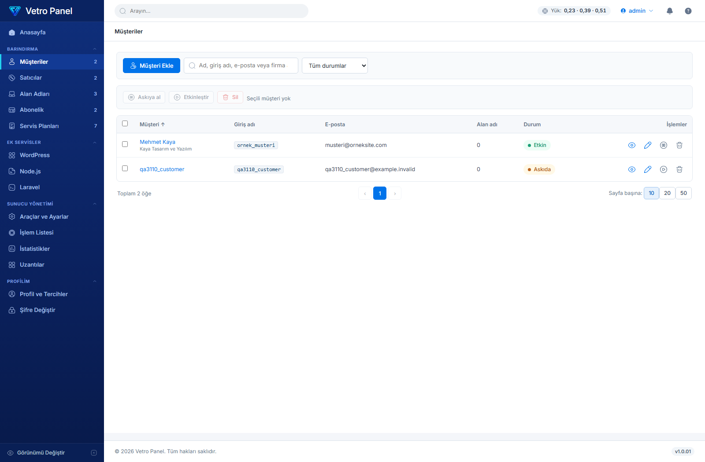

### 23. Bayi (Reseller) Yönetimi
Bayilere özel alt kullanıcı açma yetkisi, marka beyaz etiketleme (white-label) ve toplu kaynak tahsisi.
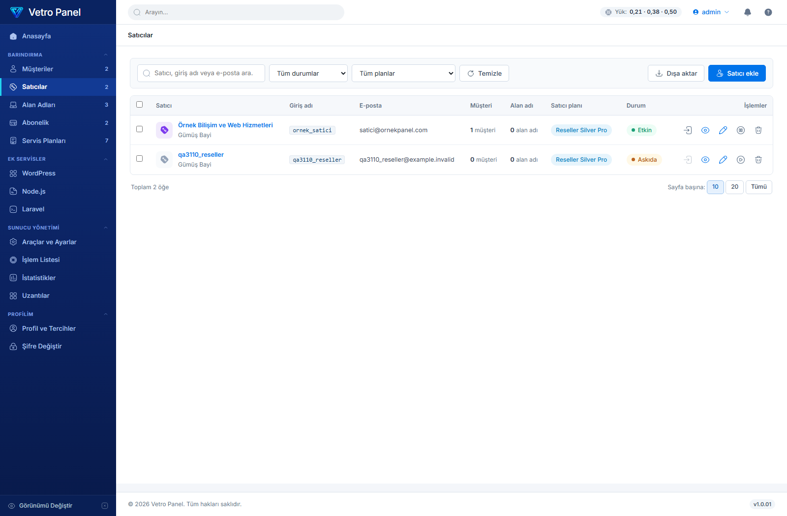

### 24. Hizmet Planları ve Paket Tanımları
Disk, trafik, e-posta, veritabanı ve site sayısı limitlerine sahip hazır hosting paketleri oluşturma.
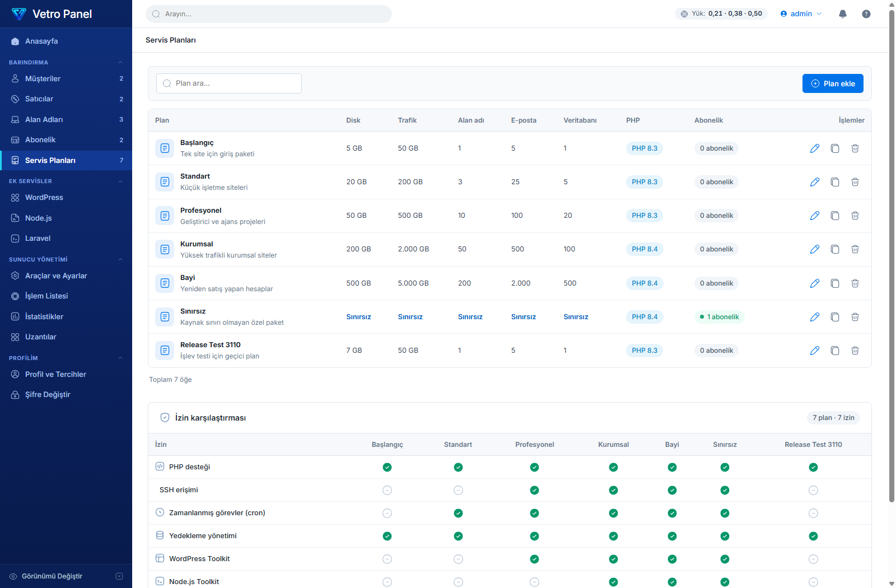

### 25. Abonelikler ve Müşteri Hizmetleri
Aktif müşteri aboneliklerinin durumu, yenileme tarihleri ve otomatik askıya alma/aktif etme kontrolleri.
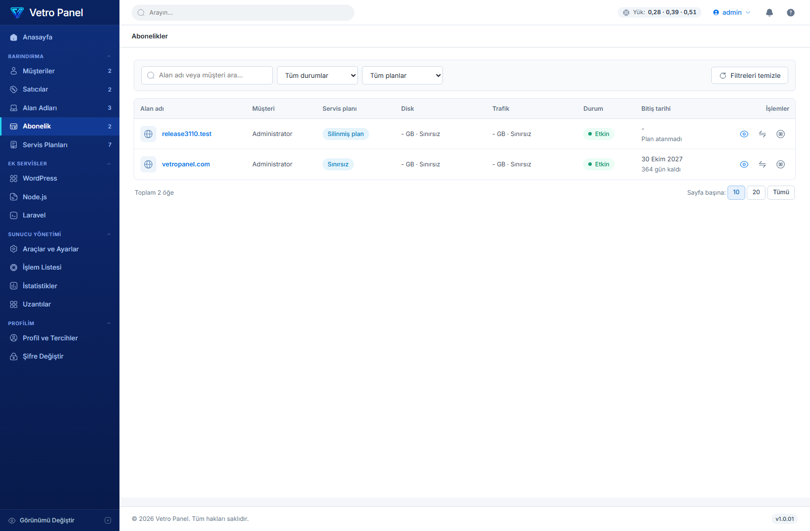

### 26. Sunucu ve Çekirdek Yapılandırma Ayarları
Panel portları, hostname, SSL politikaları, API erişim anahtarları ve sistem log seviyesi ayarları.


---

## 🌐 Desteklenen Linux Dağıtımları

zPanel v2, en yaygın kurumsal ve bulut Linux dağıtımlarında yerel ikili dosyalarla test edilmiş ve optimize edilmiştir:

| Dağıtım | Desteklenen Sürümler | Mimari | Paket Türü | Durum |
|---|---|---|---|---|
| **Ubuntu Linux** | 24.04 LTS (Noble), 22.04 LTS (Jammy), 20.04 LTS (Focal) | x86_64, aarch64 (ARM64) | `.deb` | ✅ Tam Destek |
| **Debian Linux** | Debian 12 (Bookworm), Debian 11 (Bullseye) | x86_64, aarch64 (ARM64) | `.deb` | ✅ Tam Destek |
| **AlmaLinux** | AlmaLinux 9.x, AlmaLinux 8.x (RHEL 1:1) | x86_64 | `.rpm` | ✅ RHEL 1:1 Uyumlu |
| **Rocky Linux** | Rocky Linux 9.x, Rocky Linux 8.x | x86_64 | `.rpm` | ✅ RHEL 1:1 Uyumlu |

> [!IMPORTANT]
> **Temiz Kurulum Şartı:** zPanel v2 kurulacak sunucuda daha önceden kurulmuş Apache, Nginx, MySQL veya başka bir web kontrol paneli **bulunmamalıdır**. Kurulumun saf ve temiz bir işletim sistemine (Clean OS) yapılması şarttır.

---

## ⚡ Sistem Gereksinimleri

| Bileşen | Minimum Gereksinim | Tavsiye Edilen (Üretim Ortamı) |
|---|---|---|
| **İşlemci (vCPU)** | 1 Çekirdek (1.5 GHz+) | 2+ Çekirdek (2.4 GHz+) |
| **Bellek (RAM)** | 1 GB RAM (512 MB Swap ile) | 4 GB+ RAM (Yüksek PHP & DB havuzu için) |
| **Disk Alanı** | 10 GB Boş Disk (SSD) | 40 GB+ NVMe SSD (RAID10 önerilir) |
| **Ağ & IP** | 1x Statik Genel IPv4 | 1x Statik IPv4 + /64 IPv6 Bloğu (1 Gbps Hat) |
| **Önceden Kurulu Servis** | Temiz İşletim Sistemi (Saf) | Apache / MySQL kurulu OLMAMALIDIR |
| **Açık Portlar** | 22 (SSH), 80 (HTTP), 443 (HTTPS) | 8026 (Kullanıcı Paneli), 8036 (Bayi & Root Paneli) |

---

## 📦 Dağıtım Paketleri (Bu Depoda Mevcut)

Bu depoda `PAKET/` dizini altında doğrudan sunucunuza aktarıp kurabileceğiniz resmi ikili paketler mevcuttur:

### 1. AlmaLinux / Rocky Linux / RHEL (.rpm)
Dizin: [`PAKET/ALMALINUX/`](PAKET/ALMALINUX/)
- `zpanel-1.0.09.x86_64.rpm` (Ana zPanel Yığın Paketi)
- `zpanel-core-1.0.09.x86_64.rpm` (Çekirdek Sistem Servisi)
- `zpanel-agent-1.0.09.x86_64.rpm` (Düğüm & Ajan Servisi)
- `zpanel-ui-1.0.09.x86_64.rpm` (Panel Arayüz Paketi)

Kurulum:
```bash
sudo rpm -Uvh zpanel-1.0.09.x86_64.rpm
```

### 2. Debian Linux (.deb)
Dizin: [`PAKET/DEBIAN/`](PAKET/DEBIAN/)
- `zpanel_1.0.09_amd64.deb` (Ana zPanel Yığın Paketi)
- `zpanel-core_1.0.09_amd64.deb` (Çekirdek Sistem Servisi)
- `zpanel-agent_1.0.09_amd64.deb` (Düğüm & Ajan Servisi)
- `zpanel-ui_1.0.09_amd64.deb` (Panel Arayüz Paketi)

Kurulum:
```bash
sudo dpkg -i zpanel_1.0.09_amd64.deb
```

### 3. Ubuntu Linux (.deb)
Dizin: [`PAKET/UBUNTU/`](PAKET/UBUNTU/)
- `zpanel_1.0.09_amd64.deb` (Ana zPanel Yığın Paketi)
- `zpanel-core_1.0.09_amd64.deb` (Çekirdek Sistem Servisi)
- `zpanel-agent_1.0.09_amd64.deb` (Düğüm & Ajan Servisi)
- `zpanel-ui_1.0.09_amd64.deb` (Panel Arayüz Paketi)

Kurulum:
```bash
sudo dpkg -i zpanel_1.0.09_amd64.deb
```

### 4. Kurulum Motoru İkilileri (Installer)
Dizin: [`PAKET/INSTALLER/`](PAKET/INSTALLER/)
- `install` (Otomatik bağımlılık çözümleyici ve kurulum ikilisi)
- `zpanel-installer` (Etkileşimli kurulum sihirbazı)
- `zpanel-uninstaller` (Temiz kaldırma aracı)

Çalıştırma:
```bash
chmod +x install
sudo ./install
```

---

## 🔒 Resmi Port Mimarisi

zPanel, güvenliği ve panel ayrımını sağlamak için mikro-servis mimarisinde standartlaştırılmış portları kullanır:

- **8026 / TCP (HTTPS):** Müşteri / Son Kullanıcı Kontrol Paneli (Web hosting, veritabanı, e-posta yönetimi)
- **8036 / TCP (HTTPS):** Bayi (Reseller) & Root Sunucu Yöneticisi Paneli
- **8046 / TCP (HTTPS):** Webmail Paneli
- **8047 / TLS:** İlk Kurulum & Acil Bakım Paneli
- **8056 / TCP (HTTPS):** Güvenli Dış REST API Portu (WHMCS, WISECP, PNLCS otomasyonu)
- **22 / TCP (SSH):** Güvenli Konsol Erişimi
- **80 / TCP (HTTP):** Web Yayını & ACME SSL Doğrulama
- **443 / TCP (HTTPS):** Güvenli Web Yayını (HTTP/2 & TLS 1.3)

---

## 🛠️ zpanel-cli Komut Satırı Yönetimi

Panel arayüzünün yanı sıra terminal üzerinden de tüm kontrolü sağlayan güçlü `zpanel-cli` aracı:

```bash
# Sistem ve servis durumunu görüntüle
zpanel-cli status

# Yeni alan adına Let's Encrypt SSL tanımla
zpanel-cli ssl --issue -d ornekalanadi.com

# Web sunucusunu ve PHP-FPM havuzlarını yeniden başlat
zpanel-cli restart zmaxserver php-fpm

# Tam sunucu yedeğini başlat ve S3 hedefine gönder
zpanel-cli backup --full --remote s3

# Güvenlik duvarı durumunu ve banlanan IP'leri denetle
zpanel-cli firewall --status --banned

# Panele root parolasını komut satırından sıfırla
zpanel-cli user --reset-password admin
```

---

## 🔗 Otomasyon ve Faturalandırma Eklentileri

zPanel v2'yi mevcut hosting otomasyon sisteminize entegre etmek için geliştirilmiş bağımsız resmi modüller:

### WHMCS Modülleri
- [zpanel-vps-whmcs](https://github.com/zepanel/zpanel-vps-whmcs) — WHMCS VPS / Bulut Sunucu Yönetim Modülü
- [zpanel-hosting-whmcs](https://github.com/zepanel/zpanel-hosting-whmcs) — WHMCS Web Hosting & Reseller Provizyonlama Modülü
- [zpanel-license-whmcs](https://github.com/zepanel/zpanel-license-whmcs) — WHMCS zPanel Lisans Satış ve Yetkilendirme Modülü

### WISECP Modülleri
- [zpanel-vps-wisecp](https://github.com/zepanel/zpanel-vps-wisecp) — WISECP Cloud / VPS Otomasyon Eklentisi
- [zpanel-hosting-wisecp](https://github.com/zepanel/zpanel-hosting-wisecp) — WISECP Paylaşımlı Hosting Modülü
- [zpanel-license-wisecp](https://github.com/zepanel/zpanel-license-wisecp) — WISECP zPanel Lisans ve Dağıtım Modülü

### PNLCS Modülleri
- [zpanel-vps-pnlcs](https://github.com/zepanel/zpanel-vps-pnlcs) — PNLCS VPS / Sanallaştırma Eklentisi
- [zpanel-hosting-pnlcs](https://github.com/zepanel/zpanel-hosting-pnlcs) — PNLCS Hosting & Alan Adı Entegrasyonu
- [zpanel-license-pnlcs](https://github.com/zepanel/zpanel-license-pnlcs) — PNLCS Lisans Yönetim Eklentisi

---

## 📄 Lisans ve İletişim

- **Resmi Web Sitesi:** [https://www.zepanel.com](https://www.zepanel.com)
- **Dokümantasyon & Wiki:** [https://www.zepanel.com/wiki](https://www.zepanel.com/wiki)
- **Teknik Destek:** [destek@zepanel.com](mailto:destek@zepanel.com)
- **Telif Hakkı:** © 2026 zPanel. Tüm hakları saklıdır.
