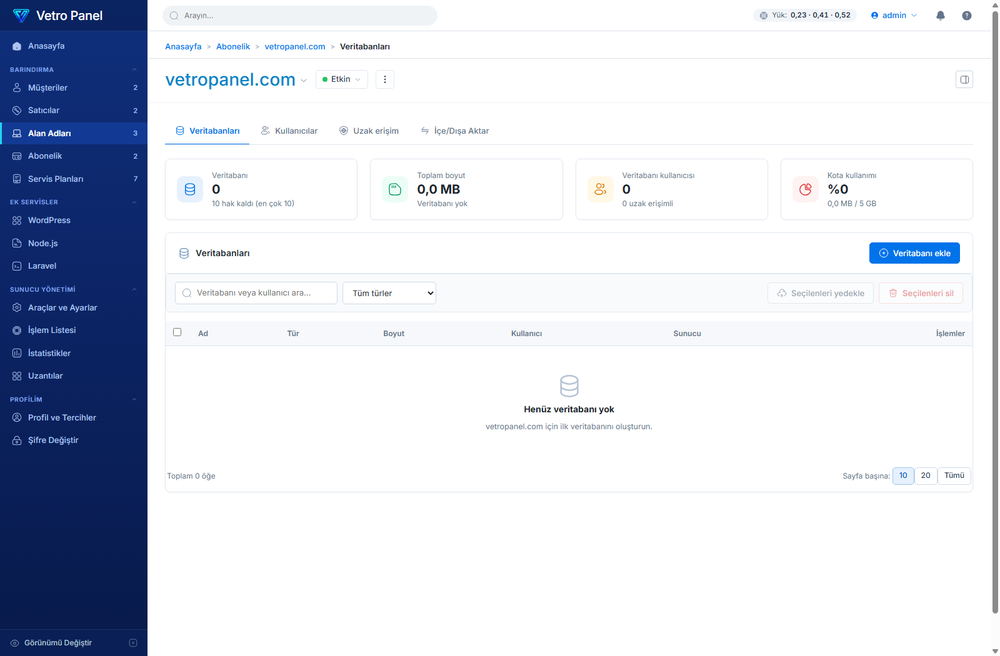
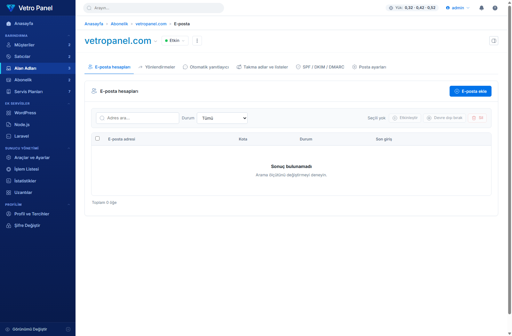
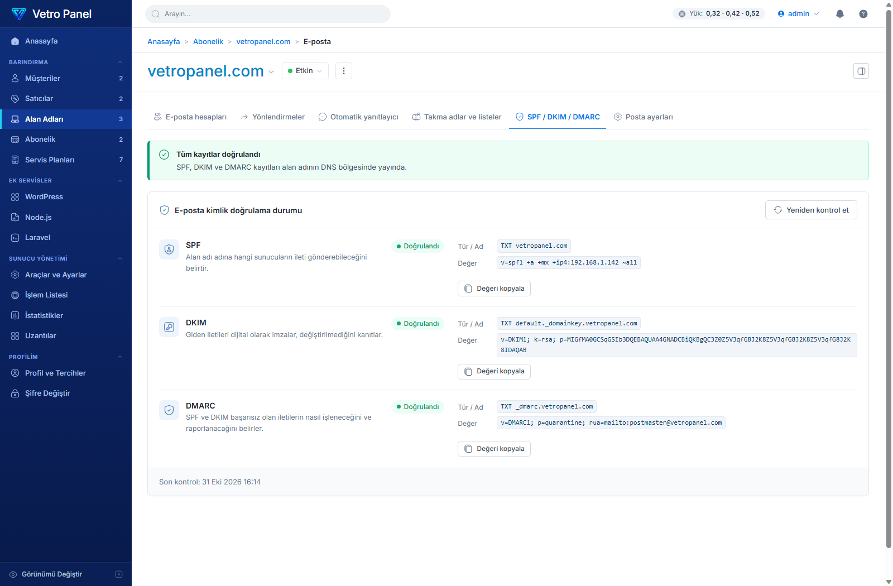
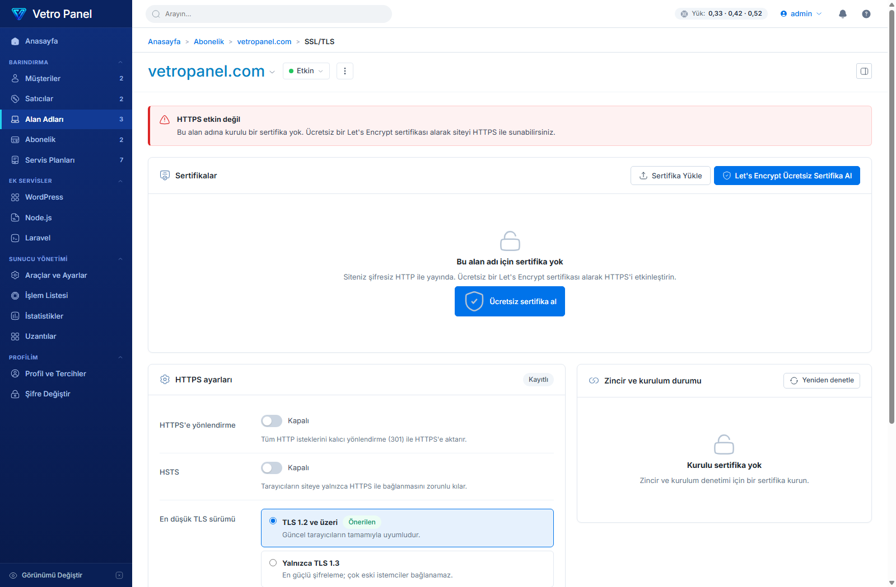
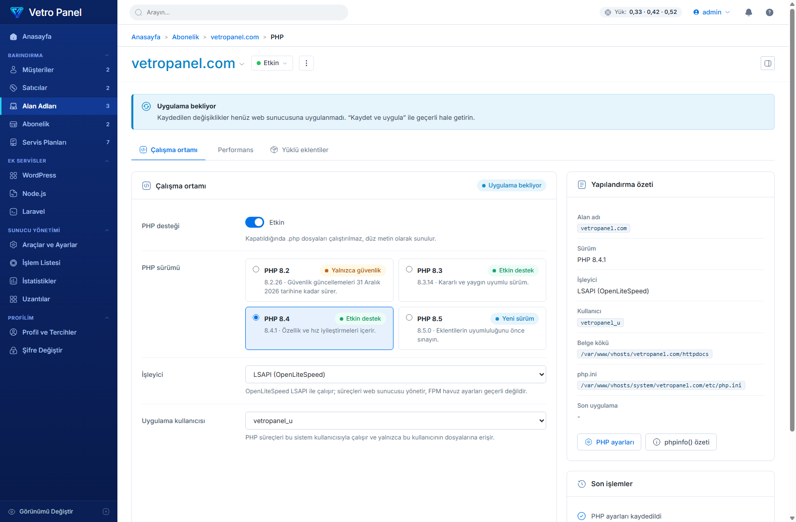
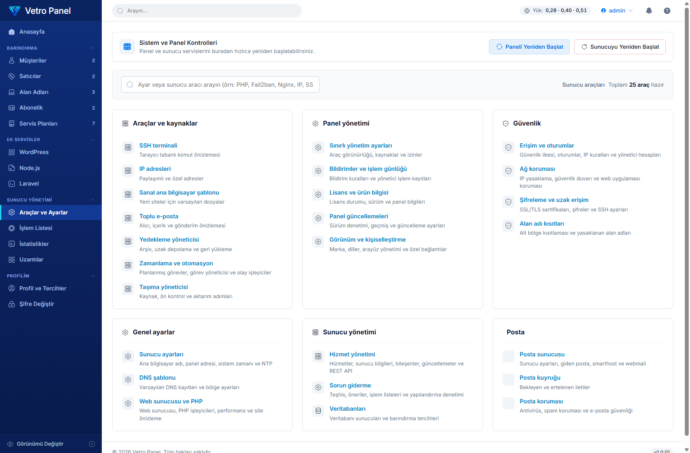
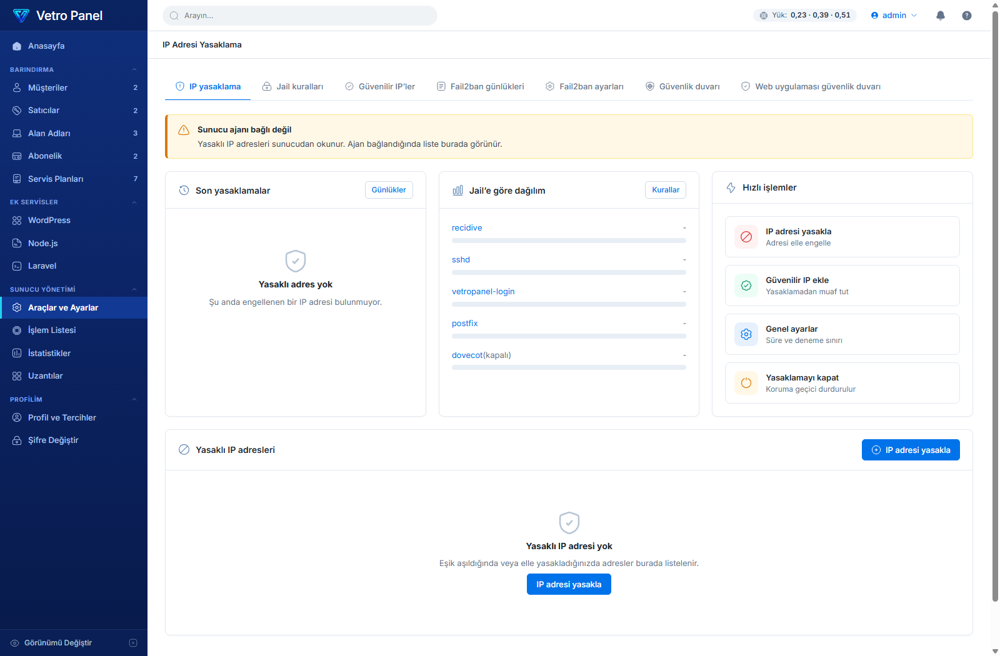
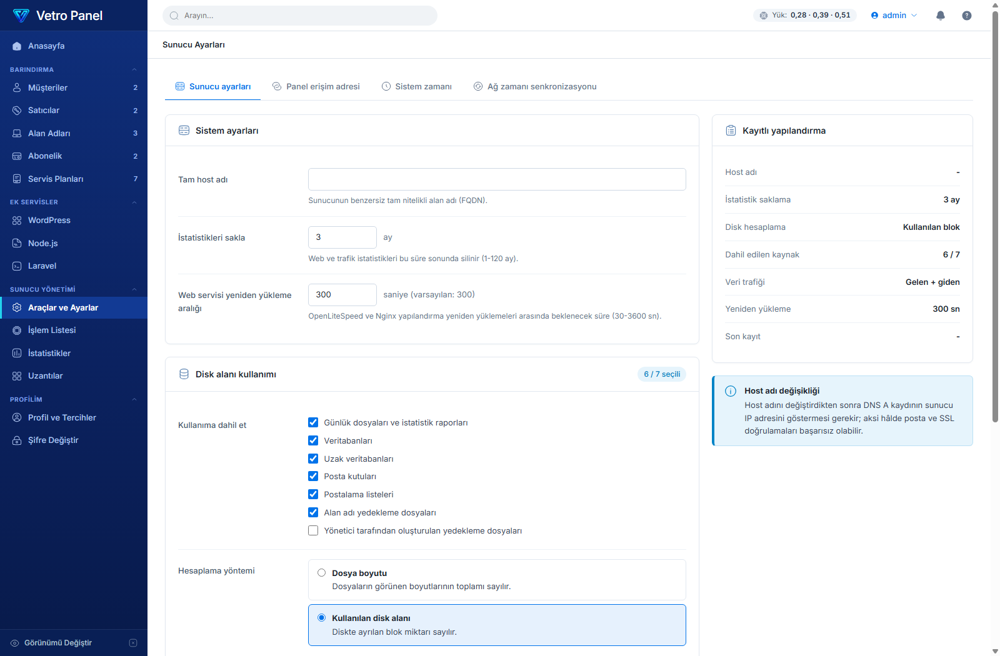

<div align="center">
  
  <br><br>
  <h1>zPanel v2 — Next-Generation Linux Server & Web Hosting Control Panel</h1>
  <p><strong>Take full control of your Linux servers, domains, corporate mailboxes, databases, and cybersecurity policies from a single, blazing-fast interface.</strong></p>
  <p>
    <a href="https://www.zepanel.com">Official Website</a> •
    <a href="https://www.zepanel.com/downloads">Download Center</a> •
    <a href="https://github.com/zepanel/zepanel/releases">GitHub Releases</a> •
    <a href="https://www.zepanel.com/features">Features</a> •
    <a href="https://www.zepanel.com/pricing">Pricing</a> •
    <a href="https://www.zepanel.com/wiki">Documentation</a>
  </p>
</div>

---

## ⚡ Overview

**zPanel v2** is a high-performance, enterprise-grade Linux server and web hosting management control panel built from the ground up with an ultra-lightweight Go and C core architecture. It replaces bloated, resource-heavy legacy panels by consuming up to **40% less memory (RAM)** while providing real-time telemetry, automated SSL, native OpenLiteSpeed/zMaxServer web engine acceleration, and hardened security.

> [!NOTE]
> This repository serves as the official presentation showcase, documentation hub, and release registry for zPanel v2. The zPanel engine is proprietary commercial software; binary installation packages are distributed via [GitHub Releases](https://github.com/zepanel/zepanel/releases/tag/v1.0.09).

---

## 🖥️ Live Interface & Visual Showcase

Below are the verified control panel screenshots featured on [www.zepanel.com](https://www.zepanel.com):

### 1. Unified Dashboard & Real-Time Telemetry
Monitor system resources (CPU, RAM, NVMe Disk, Network), active system services, and server load in real time.


### 2. Domain Names & Web Sites Management
Manage multiple domains, subdomains, DocumentRoot paths, and vHost configurations with instant HTTPS enforcement.


### 3. Databases (MySQL & MariaDB)
Create databases, manage user privileges, configure remote IP access, and perform one-click SQL import/export.


### 4. Advanced Web File Manager
Drag-and-drop file uploader, built-in archive extraction (ZIP/TAR/GZ), permission inspector, and syntax-highlighted code editor.


### 5. Corporate Mail Accounts
Custom business mailboxes with automated quota enforcement, mail forwarding, auto-responders, and Roundcube integration.


### 6. Email Security & DNS Authentication
Stop outbound and inbound spoofing with automated 2048-bit DKIM, SPF, and DMARC wizard alignment.


### 7. DNS Zone Management
Instant TTL updates for A, AAAA, CNAME, MX, TXT, SRV, and NS records powered by Bind9.


### 8. SSL / TLS Certificates
Automatic Let's Encrypt Wildcard certificate issuance, auto-renewal every 90 days, and custom certificate deployment.


### 9. Multi-PHP Version & Pool Configuration
Assign independent PHP versions per website (PHP 7.4 through PHP 8.4) with fine-grained OPcache, memory, and upload limits.


### 10. Secure FTP & SFTP Management
Isolated directories, user bandwidth restrictions, and encrypted transport rules.


### 11. Cron & Scheduled Task Automation
Manage periodic jobs with predefined templates or custom cron syntax with execution logs.


### 12. Automated Disaster Recovery & Backups
Scheduled backups for files, MySQL databases, and mailboxes to local storage or remote S3-compatible cloud buckets.


### 13. System Health & Core Diagnostic Tools
Perform vulnerability scans, port listeners check, memory leak detection, and one-click service repair.


### 14. Linux Services & Process Control
Real-time status, reload, and restart management for Nginx, Apache, OpenLiteSpeed, MariaDB, Postfix, Dovecot, and Fail2ban.


### 15. Firewall & Smart Fail2ban Defense
Automatic brute-force blacklist, jail monitoring, real-time blocked IP management, and custom port rules.


### 16. Service Plans & Hosting Packages
Package definitions, client disk/bandwidth quotas, and multi-tenant reseller allocation.


### 17. Server Core Configuration
Panel hostname, HTTPS cipher suites, API tokens, and cluster node synchronization.


---

## 🌐 Supported Linux Distributions

As documented on [zepanel.com/downloads](https://www.zepanel.com/downloads), zPanel v2 is natively compiled for:

| Operating System | Supported Releases | Architecture | Package Format | Status |
|---|---|---|---|---|
| **Ubuntu Linux** | 24.04 LTS (Noble), 22.04 LTS (Jammy), 20.04 LTS (Focal) | x86_64, aarch64 (ARM64) | `.deb` | ✅ Full Support |
| **Debian Linux** | Debian 12 (Bookworm), Debian 11 (Bullseye) | x86_64, aarch64 (ARM64) | `.deb` | ✅ Full Support |
| **AlmaLinux** | AlmaLinux 9.x, AlmaLinux 8.x | x86_64 | `.rpm` | ✅ 1:1 RHEL Compatible |
| **Rocky Linux** | Rocky Linux 9.x, Rocky Linux 8.x | x86_64 | `.rpm` | ✅ 1:1 RHEL Compatible |

> [!IMPORTANT]
> **Clean OS Requirement:** zPanel v2 must be installed on a fresh, clean Linux installation. There should be no prior Apache, Nginx, MariaDB, or third-party control panels installed.

---

## ⚙️ Hardware & System Requirements

| Component | Minimum Specification | Recommended (Production) |
|---|---|---|
| **CPU (vCPU)** | 1 Core (1.5 GHz+) | 2+ Cores (2.4 GHz+) |
| **Memory (RAM)** | 1 GB RAM (with 512 MB Swap) | 4 GB+ RAM |
| **Storage** | 10 GB Free SSD | 40 GB+ NVMe SSD (RAID10) |
| **Network & IP** | 1x Static Public IPv4 | 1x Static IPv4 + /64 IPv6 Subnet |
| **Open Ports** | 22, 80, 443 | 8026 (Client UI), 8036 (Admin & Reseller UI) |

---

## 📦 Installation Packages & GitHub Releases

Official pre-built binary packages are available in [GitHub Releases v1.0.09](https://github.com/zepanel/zepanel/releases/tag/v1.0.09):

### Quick Installation (Interactive Installer)
```bash
wget -O install https://github.com/zepanel/zepanel/releases/download/v1.0.09/install
chmod +x install
sudo ./install
```

### Manual Package Installation

#### Ubuntu & Debian (.deb)
```bash
wget https://github.com/zepanel/zepanel/releases/download/v1.0.09/zpanel_1.0.09_amd64.deb
sudo dpkg -i zpanel_1.0.09_amd64.deb
```

#### AlmaLinux & Rocky Linux / RHEL (.rpm)
```bash
wget https://github.com/zepanel/zepanel/releases/download/v1.0.09/zpanel-1.0.09.x86_64.rpm
sudo rpm -Uvh zpanel-1.0.09.x86_64.rpm
```

---

## 🔒 Port Matrix

zPanel enforces strict port segregation for enhanced security:

- **8026 / TCP (HTTPS):** End-User Client Control Panel (Websites, Databases, Mail)
- **8036 / TCP (HTTPS):** Reseller & Root Administrator Console
- **8046 / TCP (HTTPS):** Roundcube Webmail Portal
- **8047 / TLS:** First-Boot Setup & Disaster Maintenance Portal
- **8056 / TCP (HTTPS):** Secure External REST API (Billing & Provisioning Automation)
- **22 / TCP (SSH):** Secure Shell Console
- **80 / TCP (HTTP):** Web Traffic & ACME HTTP-01 Challenges
- **443 / TCP (HTTPS):** Production TLS Traffic (HTTP/2 & HTTP/3 / QUIC)

---

## 🛠️ CLI Management Tool (`zpanel-cli`)

Manage your entire cluster from the command line:

```bash
# Check overall health and service status
zpanel-cli status

# Issue Let's Encrypt SSL certificate for a domain
zpanel-cli ssl --issue -d example.com

# Restart web server and PHP-FPM daemon
zpanel-cli restart zmaxserver php-fpm

# Trigger full server backup to S3 bucket
zpanel-cli backup --full --remote s3

# List firewall status and active banned IPs
zpanel-cli firewall --status --banned

# Reset administrator password from terminal
zpanel-cli user --reset-password admin
```

---

## 🔌 Provisioning & Billing Modules

Seamlessly connect zPanel v2 with your billing automation platform:

### WHMCS Integrations
- [zpanel-vps-whmcs](https://github.com/zepanel/zpanel-vps-whmcs) — WHMCS VPS / Cloud Server Provisioning
- [zpanel-hosting-whmcs](https://github.com/zepanel/zpanel-hosting-whmcs) — WHMCS Shared & Reseller Web Hosting Module
- [zpanel-license-whmcs](https://github.com/zepanel/zpanel-license-whmcs) — WHMCS zPanel License Sales & Provisioning

### WISECP Integrations
- [zpanel-vps-wisecp](https://github.com/zepanel/zpanel-vps-wisecp) — WISECP VPS & Cloud Provisioning
- [zpanel-hosting-wisecp](https://github.com/zepanel/zpanel-hosting-wisecp) — WISECP Web Hosting Module
- [zpanel-license-wisecp](https://github.com/zepanel/zpanel-license-wisecp) — WISECP License Distribution Module

### PNLCS Integrations
- [zpanel-vps-pnlcs](https://github.com/zepanel/zpanel-vps-pnlcs) — PNLCS Cloud / VPS Module
- [zpanel-hosting-pnlcs](https://github.com/zepanel/zpanel-hosting-pnlcs) — PNLCS Web Hosting Module
- [zpanel-license-pnlcs](https://github.com/zepanel/zpanel-license-pnlcs) — PNLCS License Automation Module

---

## 📄 License & Community

- **Official Website:** [https://www.zepanel.com](https://www.zepanel.com)
- **Downloads:** [https://www.zepanel.com/downloads](https://www.zepanel.com/downloads)
- **Knowledgebase & Wiki:** [https://www.zepanel.com/wiki](https://www.zepanel.com/wiki)
- **Support:** [destek@zepanel.com](mailto:destek@zepanel.com)
- **Copyright:** © 2026 zPanel. All rights reserved.
